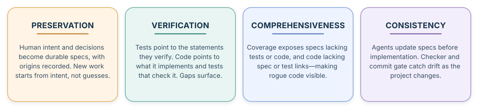
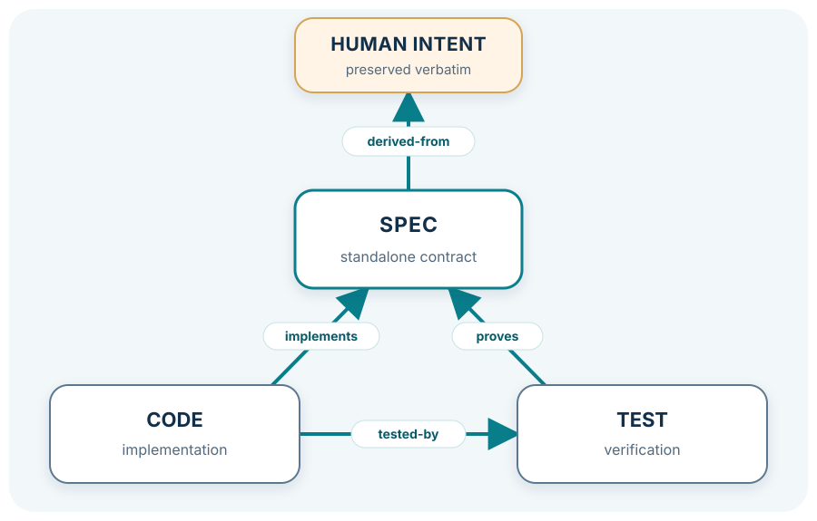

<div align="center">
  <h1>Concord</h1>
  <h2>Eliminate AI slop by keeping specifications, tests, and code in concord.</h2>
  <p><strong>Preserve human intent · Verify what was built · Find what was never specified</strong></p>
  <p><em>Keep a growing project coherent beyond any model's context window.</em></p>
</div>

Concord makes the relationship between what people ask for, what tests verify, and what code implements explicit and checkable. The project's durable memory lives in its specifications and proof links—not in a model's conversation history.

<p align="center"></p>

## Built for big projects

A model's context window is temporary. A project's specifications, tests, links, and commit gate are durable. Concord gives each new agent a way to recover the important decisions, see what evidence supports them, and continue without rebuilding the project from a chat transcript.

That is how a project can grow beyond a convincing demo: keep the intent, proof, and implementation connected as teams, packages, and codebases grow.

### Bringing Concord to an existing project

Retroactively adopting Concord is recommended. The conversion can take substantial work: a mature codebase may contain conflicting specifications, inconsistent behavior, and gaps in test coverage. Treat that effort as the cost of paying down the project's existing technical debt. As the contract, tests, and code are reconciled, the project gains a reliable foundation for future changes.

Projects adopted before November 23, 2026 should read the [migration guide for earlier Concord projects](docs/migration-20261123.md). It explains the new source-region links and `.concord` diff sidecars; existing directive-list sidecars continue to work.

## The Concord model

Concord maintains strict relationships between specs, tests, and code. These relationships allow for modularization and compartmentalization of the information coding agents need to have in context to work within the codebase.

Regardless of the impetus for a change—a new feature, a bug, or something else—the model can find the relevant starting point and follow the links to all the information required to keep the system fully specified, internally consistent, and fully tested.

<p align="center"></p>

Specifications stand alone. Test units and code regions point to the specification statements they support; each code region also points to the specific test unit that verifies it. Older links to a whole test file remain readable during migration.

<table>
  <thead>
    <tr><th>Artifact</th><th>Points to</th><th>Purpose</th></tr>
  </thead>
  <tbody>
    <tr><td><strong>Specification</strong></td><td>Nothing outside the spec set</td><td>Defines the contract without depending on today's file layout.</td></tr>
    <tr><td><strong>Test unit</strong></td><td>Specification statements</td><td>A parsed test call names the statements it proves or guards.</td></tr>
    <tr><td><strong>Code region</strong></td><td>Specification statements and test units</td><td>Names what it implements and the specific test call that verifies it.</td></tr>
  </tbody>
</table>

The checker can follow these links when code is moved or rewritten because the specification does not name source or test files. A code region's modern `@tested-by` link names one parsed test unit (`test/file.js#tu-<id>`), and Concord checks that this unit proves the same specification statement implemented by that region. Path-only `@tested-by test/file.js` remains readable for older projects and is reported as a legacy link; the map also reports implemented regions that lack a specific test-unit link.

### Source-region links

`@implements`, `@tested-by`, and `@checks` groups can label code regions; `@proves` and `@guards` groups label test regions. A group applies below its marker; groups at deeper indentation add links to their enclosing groups, while a new group at the same or lesser indentation replaces that level. An initial contiguous group of code relationship directives at the top of a file remains file-wide for compatibility. A blank line or intervening comment ends that header group, so later groups can scope regions, including the first function in the file. Concord uses these source ranges without relying on test-framework names or `describe` structure, and the context pack and graph browser can show the linked snippets instead of entire files.

For an artifact without inline Concord comments, its `<artifact-path>.concord` sidecar can contain an insertion-only unified diff with virtual directive lines at the relevant positions. A legacy sidecar containing a plain directive list is treated as a synthetic diff at the top of the file.

## Start using Concord

Install the public npm package, then initialize the project **from its root inside your coding harness**:

```sh
npm install --global @debonet/concord
cd path/to/your-project
concord init
```

If the project needs Concord pinned as a local development dependency instead of using the global command, install it with:

```sh
npm install --save-dev @debonet/concord --cache ./tmp/npm-cache
```

`concord init` creates missing baseline setup: `concord.json`, the `spec-map` and `spec-coverage` build commands, and the Concord adoption line in the root `AGENTS.md`. It detects configured languages from the project files, preserves existing settings and commands, and adds a Bash coverage declaration when it finds Bash test scripts and implementation files. It then attempts to install the pre-commit gate. If the gate finds existing specification or coverage issues, init reports them and leaves the hook uninstalled; fix the issues and rerun `concord init`.

New projects keep human intent in `intent/`, specification statements in `specs/`, and agent guidance in `guidance/`. The `intent_directories` and `guidance_directories` settings name where those files live. Existing motive and guidance markers in spec directories remain readable while a project migrates; see the [intent and guidance directory migration](docs/migration-20261125.md).

For an existing project whose `AGENTS.md` still uses the former ConcordSTC adoption or opt-out line, `concord init` updates that standalone marker while preserving the rest of the file. See the [dated adoption-line migration](docs/migration-20261115.md).

### Updating an existing installation

Before updating Concord in a project, read the project's `Concord migrations applied through: YYYY-MM-DD` line in its root `AGENTS.md`. Read and apply every dated migration guide newer than that date, in chronological order, when its conditions apply. If the line is absent, review all dated guides and apply every applicable migration. Update the line to the current date only after the migration work and each guide's required checks are complete. The date means that all migrations dated through that day have been reviewed and applied or determined not to apply.

| Relevant since | Migration guide |
| --- | --- |
| 2026-10-29 | [Reverse links](docs/migration-20261029.md) |
| 2026-10-30 | [Observations](docs/migration-20261030.md) |
| 2026-10-31 | [Dangling-pointer gate](docs/migration-20261031.md) |
| 2026-11-02 | [Settings, pending statements, and package specs](docs/migration-20261102.md) |
| 2026-11-04 | [Derived statements](docs/migration-20261104.md) |
| 2026-11-09 | [Sidecar files](docs/migration-20261109.md) |
| 2026-11-11 | [Spec-conflict candidates](docs/migration-20261111.md) |
| 2026-11-14 | [npm package](docs/migration-20261114.md) |
| 2026-11-15 | [Adoption line](docs/migration-20261115.md) |
| 2026-11-16 | [Language readers](docs/migration-20261116.md) |
| 2026-11-17 | [Bash coverage](docs/migration-20261117.md) |
| 2026-11-23 | [Projects adopted before the region-link and diff-sidecar model](docs/migration-20261123.md) |
| 2026-11-24 | [Parallel link refinement](docs/migration-20261124.md) |
| 2026-11-25 | [Separate intent and guidance files](docs/migration-20261125.md) |
| 2026-11-26 | [Specific test-unit links](docs/migration-20261126.md) |

## Instructions for agents

> **AGENT PROCEDURE · MACHINE-ORIENTED**
>
> 1. Read the project's root `AGENTS.md` and run `concord agents-sync` at the start of the session.
> 2. For behavior changes, update the owning specification first. The architect records the contract and returns a fixer plan.
> 3. The fixer implements that plan in code and tests. Tests link to the statements they verify; code links to its statements and tests.
> 4. After specification edits, run `concord spec-map --assign`, then `concord spec-map`. Run the project's full test suite and declared `spec-coverage` target before completing the fix.
> 5. Install the version-controlled pre-commit hook. It runs the configured gate so unresolved mapping errors stop a commit.
> 6. During a migration that offers link refinement, explain its scope and ask the user whether to run it; follow that guide's yes/no steps. Outside a migration, use the generated `link-refiner` agent. The coordinator chooses a fanout, starts one agent per shard, and gives each a unique `index/fanout`. Each agent reviews only its shard and follows `link-refine`'s file-boundary checkpoint instructions.

> Use the adopting project's declared commands and read its `AGENTS.md` for the full workflow. Normative requirements live in [specifications](specs/) and [agent roles](roles/).

### Commands for agents

Run commands from the adopting project root:

| Command | What it does |
| --- | --- |
| `concord init` | Creates missing project setup and attempts to install the commit gate. |
| `concord migrate` | Updates a former adoption or opt-out marker in the root `AGENTS.md`. |
| `concord agents-sync` | Generates the supported agent-tool files from Concord roles. |
| `concord spec-map` | Checks statement ids, links, completeness, and cache state. |
| `concord spec-map --assign` | Assigns placeholder statement ids and refreshes link hashes. |
| `concord spec-map --gate` | Runs the commit-blocking specification checks. |
| `concord spec-coverage` | Checks test execution coverage against linked statements. |
| `concord spec-map --clear-cache` | Clears the current project's persistent spec-map cache. |
| `concord spec-conflicts` | Refreshes ranked candidates and prints only the eligible review count. |
| `concord context --for <role> --intent "<description>" --budget <tokens>` | Finds related recorded motives from new intent text, then builds a role-specific context pack with details and pointers within the budget. |
| `concord tree [--output <path>]` | Writes a self-contained, searchable HTML browser for the project's Concord graph to `tmp/concord-tree.html` or the selected path. |
| `concord link-propose` | Suggests likely implementation links for human or agent review. |
| `concord link-refine --count [--shard <index>/<fanout>]` | Counts file-wide `@implements` / `@checks` links and legacy file-only `@tested-by` links awaiting review. |
| `concord link-refine --next [--shard <index>/<fanout>]` | Gives the generated agent its next candidate, including test-unit proof context for legacy `@tested-by` links, and says when the source file is complete. |

For a parallel refinement pass, choose a fanout (for example, the number of available agent slots) and launch one generated `link-refiner` agent per shard: `1/N` through `N/N`. Assign every shard exactly once. Candidates are hashed independently, so the same file may be edited by different agents; each agent must reread the current file and verify its directive is still at the reported location before making a minimal patch. If the directive shifted or `--mark` reports a stale candidate, fetch a fresh candidate. Each agent reads the supplied spec, source, and tests; for legacy `@tested-by` links it chooses a test unit only when that call proves a statement implemented by the code region, then scopes the link to that region. It keeps a file-wide relationship only when the whole-file claim is accurate, and removes it when false or unrelated. It runs `concord spec-map` after the final globally open candidate in each file, as directed by the command response. An agent stops only when its shard returns `available: false` and `next_command: null`; it reports its shard, reviewed count, and any problem to the coordinator. Do not inspect or edit `.concord/link-refinements.json` or `.concord/link-refinements/` manually.

To rebalance when one shard finishes much earlier, tell every active agent to finish its current candidate and stop before calling `--next`. Wait for all agents to confirm they are paused. Run `concord link-refine --count --shard <index>/<old-fanout>` once for each shard under the old fanout. Choose a new fanout for the agents that will continue, then restart them with one unique new shard each. For example, if a three-agent run is reduced to two agents, check `--shard 1/3`, `2/3`, and `3/3`, then relaunch on `1/2` and `2/2`. Do not keep any old assignment running during the new run. The stable review ids and ledger preserve completed decisions while the new fanout redistributes open candidates.

Run one final `concord spec-map` after integrating all shard work. See the [link-refiner role](roles/link-refiner.md) for the agent's complete procedure.

Use `concord context` to prepare a focused agent handoff from a new intent description. The description is supplied directly; it does not need to be recorded as a motive first. Concord ranks recorded motives by shared content words, then follows their spec links. The pack includes reachable motives and specs, plus tests and code for fixers; it fills the budget with complete node details in graph-distance order and leaves pointers for the remaining nodes. Treat lexical matches as candidates. Read pointer-only material before relying on it.

Run `concord tree` from a project root to create an offline HTML browser of its Concord graph. Open the reported output path in a browser. Use search and type filters to find motives, specifications, tests, and implementation files; select a node to inspect its text or source locations, then follow its incoming and outgoing relationships. When a user asks to see the tree, run `concord tree --output tmp/concord-tree.html` from the project root, open that file in a browser, and show the result.

The description must contain at least two paragraphs and 20 distinct content words. The budget depends on how many related nodes exist; this example allows 18,000 estimated tokens:

```sh
concord context --for architect --intent 'Improve Bash coverage reporting by measuring which executable source lines the project’s Bash tests exercise. Keep the report connected to the existing coverage command and test scripts.

Show which executable lines remain uncovered so maintainers can identify missing test cases. Preserve the current Bash test workflow, and leave report format or other behavior changes unspecified unless required by the request.' --budget 18000
```

Concord has no model access and cannot infer that different wording describes the same capability. If the description is too short or no recorded motives match, `concord context` exits with an error and asks the calling agent to generalize the user's request into 2–3 complete paragraphs. Explain the underlying capability or domain, affected area, desired outcome, and known constraints; preserve the request, label inferences, and do not add requirements. Retry with that fuller description. If it still has no matches, report that limitation instead of pretending the context pack is complete.

For Bash projects, `concord init` configures source-line measurement when it can identify Bash tests and implementation files. Bash runs can also be declared in `concord.json` with `"runner": "bash"` on a coverage run; each recognized Bash test script runs as one test unit. The coverage report maps traced Bash source lines to those scripts and lists executable command lines no test reached as uncovered. See [Bash coverage setup](docs/migration-20261117.md).

### Reviewing possible spec conflicts

Run `concord spec-conflicts` first. While `concord spec-conflicts --count` is greater than zero, launch conflict-reviewer agents in parallel up to the harness limit. Each reviewer claims its own item with `concord spec-conflicts --nextreview`; the coordinator records returned verdicts with `concord spec-conflicts --mark <id> <status>`.

**Never inspect or edit `spec-conflicts.json` manually.** The command owns the queue and ledger. Reviewers examine candidates; they do not modify the ledger. See the [conflict-reviewer role](roles/conflict-reviewer.md) and [conflict procedure](specs/spec-conflicts.md).

Concord enforces traceability and coverage rules; people still decide whether a specification is right and whether a test meaningfully exercises it. The goal is to make those judgments reviewable and durable instead of implicit.

## Learn more

- [Concord process and adoption](specs/concord-process.md)
- [Statement links and checker behavior](specs/spec-map.md)
- [Line types and the link model](specs/spec-map-line-types.md)
- [Test coverage](specs/spec-coverage.md)
- [Conflict detection](specs/spec-conflicts.md)
- [Migration guides](docs/)
- [Migration guide for projects before 2026-11-23](docs/migration-20261123.md)
- [Migration guide for separate intent and guidance files](docs/migration-20261125.md)
- [Migration guide for specific test-unit links](docs/migration-20261126.md)
- [All specifications](specs/)
